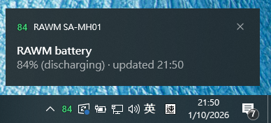
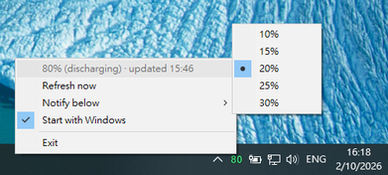

[](https://github.com/s2031215/rawm_battery/releases/latest)
[](https://github.com/s2031215/rawm_battery/releases/latest)


<a href="README.md">English</a> | **简体中文**

# RAWM SA-MH01 电池监控




一款 Windows 系统托盘应用(附带小型命令行工具),可以直接在任务栏显示
**RAWM SA-MH01 无线鼠标的电量** —— 无需安装官方 RAWM HUB 软件。

托盘图标本身就是百分比:一个大号、按电量着色的数字,自动更新 —— 数据
通过与 **RAWM Receiver** USB 接收器直接进行 HID 通信来刷新。

## 下载

可直接运行的 exe 位于
[**GitHub Releases**](https://github.com/s2031215/rawm_battery/releases) 页面

## 功能

| 功能 | 说明 |
|---|---|
| 托盘百分比图标 | 按电量着色:绿色 ≥ 40%,黄色 ≥ 30%,橙色 ≥ 20%,更低为红色;充电时为蓝色 + ⚡,首次读到数据前显示灰色 `?` |
| 自动刷新 | 每 30 分钟一次;应用启动、登录(自启动)、电脑唤醒和屏幕点亮时也会立即刷新 |
| 读取失败重试 | 鼠标休眠/离线时,每 5 分钟重试一次,而不是干等一个完整间隔 |
| 低电量提醒 | 放电状态下电量低于阈值时弹出一次气泡通知(默认 20%),每次运行只提醒一次 |
| 可调提醒阈值 | 托盘菜单 → **Notify below(低于此值提醒)** → 10 / 15 / 20 / 25 / 30%(保存在 `%APPDATA%\RAWM\tray_config.json`) |
| 开机自启动 | 托盘菜单 → **Start with Windows(开机自启动)** 开关 —— 写入当前用户的注册表 Run 键,无需管理员权限 |
| 设备信息 | 通过 `--json` 查看固件、传感器(如 PAW3395)、DPI 档位、回报率 |
| 单实例 | 重复启动不会出现重复的托盘图标 |

## 系统要求

- Windows 10 / 11
- 鼠标通过 **RAWM Receiver 接收器**(VID `1915:232A`)连接
- **打包好的 exe 完全自包含**:Python 运行时和全部依赖
  (`hidapi`、`pystray`、`Pillow`)都打包进了 exe —— 拷贝到任意
  Windows 机器上即可运行,无需安装任何东西。
- 仅从源码运行时需要:Python 3.9+,并执行
  ```bat
  pip install -r requirements.txt
  ```

## 使用

### 打包应用(推荐)

1. 从
   [GitHub Releases](https://github.com/s2031215/rawm_battery/releases/latest)
   下载 exe 并双击运行。
2. 首次读取成功后会弹出气泡确认;百分比随即出现在托盘
   (新托盘图标默认隐藏在 **`^` 溢出箭头**后面 —— 把它拖到任务栏上,
   或在*任务栏设置 → 选择哪些图标显示在任务栏上*中启用)。
3. 要在每次登录时自动启动,勾选托盘菜单中的
   **Start with Windows(开机自启动)**(当前用户的注册表 Run 项 ——
   无需管理员权限)。

托盘菜单(右键):

- **状态行** —— 当前百分比、充电状态、最后更新时间、重试信息
- **Refresh now(立即刷新)** *(默认项,加粗 —— 左键单击图标同样触发)*
  —— 强制立即重新读取,并以通知形式显示结果
  (鼠标无响应时则显示失败原因)
- **Notify below(低于此值提醒)** —— 选择低电量提醒阈值(10–30%)
- **Start with Windows(开机自启动)** —— 勾选后登录时自动启动应用
  (每次打开菜单都会重新读取注册表/快捷方式的实际状态;
  取消勾选还会移除旧版本遗留在启动文件夹中的快捷方式)
- **版本行** —— 应用版本号(与 `rawm_battery.spec` 保持同步)
- **Exit(退出)**

### 命令行

```bat
python rawm_battery.py                 :: 单次查询: "SA-MH01 battery: 85% (discharging)"
python rawm_battery.py --json          :: 完整设备信息(固件、DPI、回报率……)
python rawm_battery.py --watch         :: 轮询并打印变化(默认每 30 分钟一次)
python rawm_battery.py --watch --interval 5
python rawm_battery.py --debug         :: 输出原始 HID 报文
```

命令行只需要 `pip install hidapi`。

### 从 Python 调用

```python
from rawm_battery import read_battery

status = read_battery()          # {"battery": 85, "chr": 0, "dn": "SA-MH01", ...}
print(status["battery"], status["chr"])
```

如果接收器未插入,或鼠标在超时时间内没有响应,会抛出
`rawm_battery.RawmReceiverError`(移动/点击鼠标唤醒它后重试)。

## 构建

```bat
pip install -r requirements.txt

python -m PyInstaller --noconfirm --clean rawm_battery.spec
```

- 所有发布版本共用一个 spec:修改 `rawm_battery.spec` 顶部的
  `VERSION`(保持 `version.txt` 同步)后重新构建 —— 输出为
  `dist\RAWM.SA-MH01-v<VERSION>-x64.exe`(单文件,目标机器无需
  安装 Python)。
- `version.txt` 设置 exe 的元数据 —— 其中的 `FileDescription` 就是
  Windows 显示的通知应用名("RAWM SA-MH01" 而不是 "Python")。
- **构建前请先关闭正在运行的 exe** —— 文件被占用时无法覆盖。

## 工作原理

HID 协议是通过逆向 RAWM 官方网页版 HUB
([rawmtech.com/hub.html](https://www.rawmtech.com/hub.html))得到的 ——
厂商并未公开文档。接收器的厂商 HID collection(usage page
`0xFF00`)上运行着一种带帧结构的事件协议:

1. 向接收器发送 `CMD_QUERY` 事件,包裹在扩展通道头
   (`0xC0 | 通道 0`)中,经 2.4 GHz 转发给鼠标。
2. 鼠标回复一个 JSON 数据块(`"battery"`、`"chr"`、`"dn"`、`"cpi"`……),
   帧格式为 `FF FF FF FF [cmd|len_hi] [len_lo] <payload>`。
3. 电量也会以推送通知的形式到达(`CMD_NOTIFY`,类型 `0x17`:
   百分比 + 充电标志),RSSI 则为类型 `0x1C`。

`rawm_battery.py` 实现了查询/解析;`rawm_power.py` 监听 Windows
电源事件(`WM_POWERBROADCAST`:系统恢复 + `GUID_MONITOR_POWER_ON`)
以触发额外刷新。

## 文件

| 文件 | 用途 |
|---|---|
| `rawm_battery.py` | HID 协议 + 命令行(`read_battery()`、`watch()`) |
| `rawm_tray.py` | 托盘应用(图标、菜单、通知、刷新调度) |
| `rawm_power.py` | 唤醒/屏幕点亮事件监听 |
| `rawm_autostart.py` | 开机自启动注册表 Run 键开关 |
| `requirements.txt` | Python 依赖(运行 + 构建),版本已锁定 |
| `dist` | 打包好的应用 |
| `rawm.ico` | 应用图标 |
| `version.txt` | exe 版本元数据(通知应用名) |
| `rawm_battery.spec` | 共享 PyInstaller spec(每次发布修改 `VERSION`) |
| `test_power_watch.py` | 电源监听组件测试 |
| `test_autostart.py` | 自启动开关组件测试 |

## 故障排除

- **"RAWM Receiver not found"(找不到接收器)** —— 接收器未插入
  (或被其他程序独占);重新插拔接收器。
- **"No answer from the mouse"(鼠标无响应)** —— 鼠标在休眠或超出
  范围;移动或点击它。失败的检查会在 5 分钟后自动重试。
- **百分比看起来过期** —— 悬停图标:工具提示会显示更新时间;
  使用*立即刷新*,或等待下一次计划/唤醒后的检查。
- **托盘里看不到图标** —— 检查 `^` 溢出区;固定方法:
  *任务栏设置 → 选择哪些图标显示在任务栏上 → rawm_battery*。

## 免责声明

非官方工具,仅供个人使用;与 RAWM 无关联。HID 协议没有官方文档,
可能随固件更新而变化 —— 如果工具在固件更新后失效,需要从官方配套
软件的通信流量中重新推导上述命令/通知格式。
